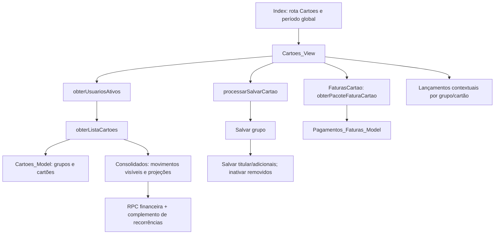

# Estudo de Cartões — base em produção

24/10/2026. Projeto Apps Script `1ySSYm83KZiFi_1nT-cgsPFtN8in5lvHQocl856b0XzLz303USM-c-2Fd`;
Supabase `wcczkultokrypdfimbsh`. Inspeção de código, catálogo real e contagens agregadas.
Não foram copiados nomes, e-mails, movimentos ou valores financeiros de usuários.
Nenhuma tabela ou rotina de Cartões foi alterada nesta rodada.

## Modelo confirmado no banco

| Tabela | Conteúdo e relações | Comparação com o código |
| --- | --- | --- |
| `grupos_cartoes` | UUID, titular → `usuarios`, nome, limite `numeric(14,2)`, dia de fechamento, dia de vencimento, ativo, timestamps | Unidade que reúne limite, configuração e fatura; não é um cartão físico |
| `cartoes` | UUID, grupo → `grupos_cartoes`, usuário → `usuarios`, nome, tipo Titular/Adicional, ativo, timestamps | Um cartão lógico por usuário em cada grupo; `UNIQUE(id_grupo_cartao,id_usuario)` |
| `cartoes_compartilhados` | Cartão, usuário, ativo, papel, timestamps; vínculo único por cartão/usuário | Estrutura legada lida pelos contextos; o model atual reconstrói compartilhamento a partir dos cartões ativos do grupo |
| `lancamentos` | `tipo_origem`, `id_origem`, valor, ocorrência, competência, parcelas, recorrência etc. | Quando a origem é Cartão, `id_origem` identifica **o cartão físico**, não o grupo; vínculo polimórfico sem FK direta para `cartoes` |
| `pagamentos_faturas` | Grupo → `grupos_cartoes`, conta → `contas`, valor, data, competência, status, autor e timestamps | Pagamento da fatura separado das despesas de compra; reduz a conta sem representar outra despesa |
| `recorrencias` / `recorrencias_ocorrencias` | Origem no cartão e controle de ocorrências geradas | Projeção de compras ainda não geradas, que precisa evitar duplicar ocorrências já lançadas |
| `rateios` / `acertos_rateios` | Participações e acertos relacionados a movimentos/pagamentos | Dependências de autorização e resultado individual; não são adicionais do cartão |

O banco tem **7 grupos, 10 cartões (7 titulares e 3 adicionais), 22 pagamentos,
847 lançamentos de cartão e 7 recorrências de cartão**. Todos os grupos/cartões
estão ativos; não existem vínculos legados ativos em `cartoes_compartilhados`.
Não foram encontrados grupos sem exatamente um cartão de titular correspondente,
limites negativos, nomes repetidos por titular após trim/casefold, tipos divergentes
do proprietário, dias fora de 1–31 ou lançamentos de cartão sem cartão correspondente.
São conferências pontuais de integridade, não homologação financeira.

Há índices por titular/status, usuário/status, grupo/status e grupo/competência
para pagamentos. O banco restringe os dias a 1–31 e o tipo do cartão, mas não
impõe limite não negativo, nome normalizado único por titular, nem versão de
edição/recibo de operação. Esses pontos hoje ficam parcialmente no controller.
As tabelas do módulo não têm RLS habilitada, mas não concedem SELECT aos papéis
`anon` e `authenticated`; o acesso observado é pelo backend `service_role`.
A implementação futura deve manter a sessão do Apps Script como fronteira de
autorização e proteger suas novas RPCs; não presumir Supabase Auth.

## Relações entre as rotinas

Fontes principais: `Cartoes_View.html`, `Cartoes_Controller.js`, `Cartoes_Model.js`,
`Faturas_Cartao_Controller.js`, `Supabase_Contexto.js`, `Lancamentos_Controller.js`
e `Consolidados_Controller.js`.

## O que já existe e deve ser preservado

- Cadastro e edição do grupo, com limite, fechamento, vencimento e adicionais.
- Somente titular altera cadastro e status. Criação atribui o titular pela sessão.
- Titular recebe cartão próprio automaticamente; adicionais escolhidos recebem cartão.
- Retirar um adicional inativa seu cartão, preservando o ID e os lançamentos.
- Nome duplicado é impedido pelo controller por titular, incluindo grupos inativos.
- Inativação do grupo preserva os movimentos e impede o uso ativo dos seus cartões.
- Fatura e lançamentos podem ser abertos mantendo grupo/cartão e período.
- Compra até o dia de fechamento entra na competência corrente; depois, na seguinte.
- Parcelas e recorrências já alimentam os cálculos da base.
- Os contextos filtram movimentos por autor, origem e participação. O titular acessa
  cartões do grupo; um adicional não ganha acesso geral aos movimentos dos outros.

## Achados que orientam a remodelagem

### Carregamento

`inicializarTelaCartoes` espera a consulta de todos os usuários antes de pedir a
lista. Se a consulta de usuários falha, a lista não é carregada por esse caminho.
Participantes de um formulário eventual bloqueiam a primeira leitura da tela.

O model de cartões consulta grupos novamente para enriquecer os cartões; a lista
já havia consultado esses grupos. O controller também lê movimentos/recorrências
para descobrir vínculos históricos, busca o contexto financeiro e complementa
recorrências. Existe trabalho repetido e transferência de pacotes amplos. Não foi
medida a latência real de uma sessão autenticada; não se atribui aqui um ganho em
milissegundos.

O servidor captura falhas do consolidado e entrega números de um consolidado
vazio. A View também conserva estrutura no localStorage e pode repor uma lista
com valores zerados. Isso mistura “sem movimento” e “não foi possível consultar”.
Os novos componentes devem ter estados distintos de carregamento, zero e erro.

### Valores e escopo

`montarConsolidadoPeriodoCartoesController_` soma compras e previsões e calcula
disponível como limite menos essa soma, **sem abater pagamentos**. Em
`obterPacoteFaturaCartao`, os subtotais também incluem previsões, mas o saldo em
aberto desconta pagamentos. Portanto, lista e fatura podem exibir valores distintos
para um rótulo que parece equivalente.

Isso foi reproduzido em Node executando as funções atuais com dados fictícios:
limite R$ 10.000, compras R$ 1.840, previsões R$ 180 e pagamentos R$ 440.
A lista retornou fatura R$ 2.020 e disponível R$ 7.980; a Fatura retornou total
R$ 2.020, pago R$ 440, em aberto R$ 1.580 e disponível R$ 8.420. A diferença
foi demonstrada no código, não inferida de valores pessoais. A proposta separa
registrado e previsto e recomenda o mesmo contrato para os dois lugares.

Além disso, a fatura filtra cartões acessíveis, enquanto os pagamentos são ligados
ao grupo. Para um adicional, misturar subtotal de seus cartões com pagamentos do
grupo pode produzir um saldo com escopos diferentes. Precisa de contrato explícito;
a remodelagem visual não deve transformar esse subtotal em “total da fatura”.

Em vários meses, comparar a soma de todas as faturas com um único limite cadastrado
não representa disponibilidade instantânea. O banco não possui integração com o
banco emissor, reservas de limite nem limite individual de adicional. Não prometer
“limite real disponível” com os dados existentes.

### Gravação e histórico

`processarSalvarCartao` usa um lock global do script e várias gravações REST:
primeiro grupo, depois cartões, depois inativações. O lock não torna essas chamadas
uma única transação no Postgres. Falha intermediária pode deixar estado parcial;
o cadastro novo recebe outro UUID ao repetir uma solicitação sem ID. Não há versão
esperada contra edição concorrente. O status é uma alternância, sem estado desejado
explícito nem recibo de repetição.

A leitura recalcula competências com o fechamento atual, mesmo havendo competência
registrada em `lancamentos`. Alterar o fechamento pode deslocar compras históricas.
A proposta recomenda apresentar impacto e preservar os vínculos; uma mudança de
regra histórica exige decisão própria antes da implementação correspondente.

`dia_vencimento` é um número do mês. O código observado exibe “dia N”; não define
sozinho uma data completa de vencimento relativa ao fechamento nem ajusta feriados.
Não há fundamento para inventar contagem de atraso ou “vence amanhã” nesta rodada.

### Interface

A View concentra introduções, formulário com vários campos, lista de checkboxes,
tabela de grupos, cartões físicos e várias ações. A adaptação para celular mantém
a mesma estrutura de origem. Não oferece busca de grupos, filtro local por papel
ou separação clara entre tarefa principal, edição e detalhes.

A unidade a manter na lista é a fatura/grupo. Cartões do titular e dos adicionais
ficam em um detalhe progressivo, sem repetição do limite para cada adicional.

## Evolução após o estudo

Este documento descreve a base analisada na versão 34. A implementação posterior
em **Cartões (novo)** trata carregamento, gravação e resumo conforme a
[entrega](cartoes-entrega.md). A preservação de competências foi implementada e a
permissão de pagamentos para adicionais foi confirmada pelo usuário.
