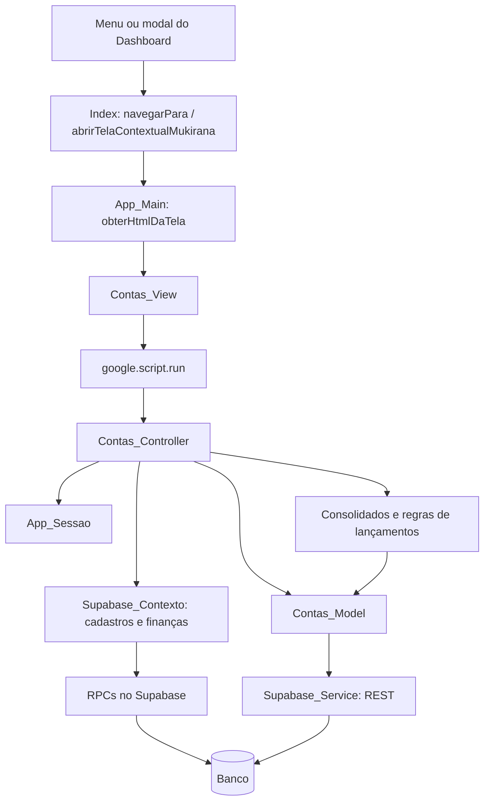

# Estudo da tela de Contas

Data: 24/10/2026. Base: Mukirana 1.9, versão 32 do Apps Script
`1ySSYm83KZiFi_1nT-cgsPFtN8in5lvHQocl856b0XzLz303USM-c-2Fd`.
Banco conferido pelo catálogo real: Supabase `wcczkultokrypdfimbsh`.

O estudo cobre interface, navegação, autorização, leitura/gravação e dependências
financeiras. Foram consultados código e metadados; não foram lidos registros
financeiros/pessoais nem executadas gravações ou mudanças de schema. As conclusões
de interface são da leitura do código, sem homologação funcional autenticada.

## Arquivos e responsabilidades

| Arquivo | Responsabilidade |
| --- | --- |
| `Index.html` | Menu, navegação, execução dos scripts da tela, filtro global, topbar, notificações, confirmações, moeda e modais contextuais |
| `App_Main.js` | `obterHtmlDaTela('Contas', token)` valida sessão e inclui `Contas_View` |
| `Contas_View.html` | Listagem, formulário, compartilhamento, filtros, ações e chamadas `google.script.run` |
| `Contas_Controller.js` | Sessão, regras, permissões, montagem do retorno e integração dos consolidados |
| `Contas_Model.js` | Leitura/escrita das contas e sincronização dos compartilhamentos; mantém compatibilidade com planilha |
| `Database_Service.js` | Seleção da fonte `SUPABASE` ou `PLANILHA` |
| `Supabase_Contexto.js` | RPCs de cadastros/finanças e conversão do JSON para os contratos antigos dos controllers |
| `Supabase_Service.js` | REST e RPC com chave server-side em propriedades privadas do script |
| `Consolidados_Controller.js` | Visibilidade dos movimentos, saldo por conta, período e previsão de recorrências |
| `Lancamentos_Controller.js` | Contas utilizáveis, visibilidade/gestão dos movimentos e integração com lançamentos |
| `App_Sessao.js` | Sessão própria, expiração e usuário ativo, com cache curto do usuário |
| `App_Performance.js` | Medições de etapas e contagens no Logger |



## Entrada e comportamento da interface

O menu chama `navegarPara('Contas')`. A resposta de `obterHtmlDaTela` é injetada no
conteúdo principal; o `Index` recria os elementos `script` para executá-los.
O Dashboard também abre Contas em modal contextual e fornece callback para se
atualizar depois da gravação.

A tela oferece:

- Listagem alfabética das contas próprias e compartilhadas acessíveis, mostrando nome/contexto, saldo inicial, saldo, resultado do período, status e ações.
- Ativas por padrão; “Exibir contas inativas” inclui também as inativas.
- Cadastro/edição de nome, saldo inicial, marca de compartilhamento e participantes.
- Ações Salvar, Salvar + novo, Cancelar, Editar/Ver, Inativar/Restaurar e Lançamentos.
- Confirmação ao mudar o saldo inicial de uma conta existente e ao inativar/restaurar.
- Previsões de recorrência em linhas adicionais, até quatro detalhes por conta e um resumo das demais.

O período vem de `obterFiltroPeriodoGlobalMukirana()`, salvo no localStorage como
`mukirana_filtro_periodo_global`. Há campos de mês na própria View, atualmente
ocultos. Ao entrar, a View consome/removerá também o filtro contextual
`mukirana_filtros_contas`. A tela se registra em `registrarTelaAtualMukirana`
para responder às mudanças do período global.

Estados locais: `contasEmMemoria`, `usuariosCompartilhaveisConta`,
`mostrarContasInativas`, `tokenSessao` e `modoAposSalvarConta`.
O ID de usuário lido do localStorage não é a autoridade das operações: os
controllers usam `obterSessaoObrigatoria(token)`.

## Relações entre as funções

| Ação | Encadeamento principal |
| --- | --- |
| Abrir | `inicializarTelaContas` → `carregarUsuariosParaSelecaoConta` → `obterUsuariosCompartilhaveisConta` → `carregarTabelaContas` |
| Listar | `carregarTabelaContas` → `obterListaContas` → contextos de cadastros/finanças → `montarContaParaViewController_` → `renderizarTabelaContas` |
| Editar/consultar | `prepararEdicaoConta` usa a conta em memória, recarrega usuários compartilháveis e aplica `configurarModoEdicaoConta` |
| Salvar | `enviarFormularioConta` → confirmação de saldo quando aplicável → `salvarContaComDados` → `processarSalvarConta` → `salvarContaModel` |
| Persistir no Supabase | `salvarContaSupabaseModel_` → upsert de `contas` → `sincronizarCompartilhamentosContaSupabase_` |
| Inativar/restaurar | `alterarStatusContaFront` → confirmação → `alternarStatusConta` → `alterarStatusContaModel` → PATCH em `contas` |
| Ver movimentos | `abrirLancamentosConta` → `abrirLancamentosContextuaisMukirana`, mantendo conta e período de origem |

Depois de salvar, a View atualiza a lista, abre novo cadastro ou fecha o formulário
e, quando estiver em modal, atualiza a tela de origem.

### Consulta e retorno

`obterListaContas(token, filtros)` executa:

1. Validação da sessão e normalização do intervalo de meses.
2. `montarContextoListaContasController_`: tenta `rpc_cadastros_mukirana` com vínculos; em falha usa Models.
3. Mapeamento das contas com lançamentos e cálculo de `montarConsolidadoPeriodoContasController_`.
4. Filtro de contas por propriedade/compartilhamento.
5. Montagem dos atributos cadastrais, permissões e `Consolidado_Periodo`.

O contrato inclui `ID_Conta`, `ID_Usuario`, `Nome_Conta`, `Saldo_Inicial`,
`Ativa`, `Compartilhada`, `Usuarios_Compartilhados`, `Tem_Lancamentos`,
`Eh_Dono`, `Eh_Compartilhada_Comigo`, `Pode_Editar`, `Pode_Alterar_Status`,
`Pode_Gerenciar_Compartilhamento`, `Nome_Dono` e `Consolidado_Periodo`.
`_linhaPlanilha` permanece por compatibilidade; no Supabase é uma posição
sintética e não deve substituir o UUID como identidade.

### Regras do cadastro

- Só o proprietário edita cadastro, saldo inicial, status e compartilhamento.
- Participantes podem consultar o cadastro e usar a conta ativa em lançamentos, conforme regras desse módulo.
- O nome é obrigatório; a comparação usa trim e minúsculas e procura duplicidade entre as contas acessíveis ao usuário que está salvando, inclusive inativas.
- Participantes informados precisam existir e estar ativos; o dono não deve ser enviado na lista de participantes.
- Nova conta começa ativa; na edição, proprietário e status vêm do registro confiável do servidor.
- A tela não oferece exclusão física; inativação preserva os registros e permite restauração.
- Há trava global de script durante o salvamento, com espera de até 30 segundos. A alternância de status não usa a mesma trava.
- Esta versão não possui campo de tipo de conta Consumo/Investimento/Cartão. Cartões têm módulo próprio. O saldo inicial é um atributo da conta, sem lançamento especial e sem data inicial própria.

## Persistência real

### `public.contas`

| Campo | Tipo | Obrigatório / comportamento |
| --- | --- | --- |
| `id_conta` | uuid | PK; padrão `gen_random_uuid()` |
| `id_usuario` | uuid | Proprietário; FK para `usuarios`, exclusão restrita |
| `nome_conta` | text | NOT NULL; obrigatoriedade/duplicidade textual verificadas no controller |
| `saldo_inicial` | numeric(14,2) | NOT NULL; padrão 0 |
| `ativa` | boolean | NOT NULL; padrão true |
| `compartilhada` | boolean | NOT NULL; padrão false |
| `created_at` | timestamptz | NOT NULL; padrão now() |
| `updated_at` | timestamptz | NOT NULL; padrão now(), atualizado explicitamente pelo Model |

Índices: PK e `(id_usuario, ativa)`. Não há unique para nome, campo de versão
concorrente, coluna de saldo atual ou trigger nessa tabela.

### `public.contas_compartilhamentos`

| Campo | Tipo | Obrigatório / comportamento |
| --- | --- | --- |
| `id_compartilhamento` | uuid | PK; banco oferece UUID aleatório; Model usa UUID determinístico de conta/usuário |
| `id_conta` | uuid | FK para `contas`; ON DELETE CASCADE |
| `id_usuario` | uuid | FK para `usuarios`; ON DELETE RESTRICT |
| `ativo` | boolean | NOT NULL; padrão true |
| `papel_na_conta` | text | NOT NULL; padrão Participante; check Dono ou Participante |
| `created_at` | timestamptz | NOT NULL; padrão now() |
| `updated_at` | timestamptz | NOT NULL; padrão now(), atualizado pelo Model |

Todos os campos são NOT NULL. Há unique `(id_conta, id_usuario)` e índice
`(id_usuario, ativo)`. Não há trigger nessa tabela.

O Model mantém vínculo ativo do próprio dono, mesmo numa conta individual.
Para editar participantes, primeiro desativa todos os vínculos da conta e depois
reativa/cria os selecionados e o dono. Participantes removidos ficam registrados
com `ativo=false`. As leituras excluem o papel Dono da lista de participantes.

### Relações com outros dados

| Relação | Natureza |
| --- | --- |
| `usuarios.id_usuario` → `contas.id_usuario` | Proprietário da conta |
| `usuarios.id_usuario` → `contas_compartilhamentos.id_usuario` | Pessoa vinculada |
| `contas.id_conta` → `contas_compartilhamentos.id_conta` | Membros e permissões |
| `lancamentos.id_origem` com `tipo_origem='Conta'` | Vínculo lógico; a origem também pode representar cartão, portanto não há FK direta para contas nessa coluna |
| `lancamentos.id_destino` → `contas.id_conta` | FK com exclusão restrita, usada nas transferências |
| `pagamentos_faturas.id_conta` → `contas.id_conta` | FK com exclusão restrita; reduz o saldo da conta pagadora |
| `recorrencias.id_origem` com `tipo_origem='Conta'` | Vínculo lógico de origem |
| `recorrencias.id_destino` → `contas.id_conta` | FK com exclusão restrita, para destino de transferências previstas |
| `acertos_rateios.id_conta_devedor/id_conta_credor` → `contas.id_conta` | FKs existentes no banco; não há consumo direto dessa tabela no código Apps Script importado |

## Saldos, período e recorrências

O saldo mostrado é calculado no Apps Script; não é persistido em `contas`.
O caminho financeiro é `montarConsolidadoPeriodoContasController_` →
`obterContextoFinanceiroSupabaseRpc_` → `rpc_contexto_financeiro_mukirana` →
`montarContextoConsolidadosAPartirBase_` → visibilidade dos movimentos e cálculos.

Com histórico anterior habilitado, `Saldo_Lancado` parte do saldo inicial e soma
os movimentos visíveis com data de ocorrência até o final do mês selecionado:
receitas e transferências recebidas entram; despesas, transferências enviadas e
pagamentos de faturas saem. Esse nome não significa necessariamente saldo até hoje.
Sem histórico, usa movimento no mês de referência e começa em zero.

O `Resultado_Periodo` usa o intervalo de meses de referência; pagamentos de
fatura consideram sua data de pagamento, com fallback para mês de referência.
As recorrências ativas ainda não efetivadas são simuladas no intervalo e
acrescentam `Total_Recorrencias_Programadas`. Ao final, o controller define:

```
Resultado_Periodo_Projetado = Resultado_Periodo + Total_Recorrencias_Programadas
Saldo_Projetado = Saldo_Lancado + Total_Recorrencias_Programadas
```

As previsões exibidas têm `Somente_Leitura=true`. O gerador verifica ocorrências
já geradas e vínculos com lançamentos para evitar duplicar a previsão. As tabelas
`recorrencias_rateios` e `recorrencias_ocorrencias` participam desse contexto.

As regras de visibilidade consideram autoria, rateios e gestão da origem. O dono
da conta tem gestão sobre seus movimentos. Ser participante da conta não concede,
por si só, a visualização irrestrita de todos os movimentos dela. Portanto os
consolidados dependem da sessão; isso exige atenção na apresentação da nova tela.

## Pontos técnicos encontrados

### Autorização — confirmado no catálogo e no código

`contas` e `contas_compartilhamentos` estão sem RLS. As concessões diretas
consultadas dão acesso às tabelas a `service_role`, sem grants diretos a `anon`
ou `authenticated`. As regras normais da tela são aplicadas nos controllers.

Porém as duas RPCs de contexto são `SECURITY DEFINER` e mantêm execução para
PUBLIC. Foi confirmada permissão efetiva de execução por `anon` e
`authenticated`, com uso do schema `public`. Seus corpos não validam a sessão
do aplicativo. A RPC de cadastros não usa seu parâmetro de usuário para filtrar
o conjunto de cadastros. Ambas incluem linhas completas de `usuarios`, cuja
estrutura contém `senha_pin`. Não foram consultados os valores dessas linhas.

Os advisors confirmaram dois alertas de execução de funções privilegiadas:
[anon](https://supabase.com/docs/guides/database/database-linter?lint=0028_anon_security_definer_function_executable)
e [authenticated](https://supabase.com/docs/guides/database/database-linter?lint=0029_authenticated_security_definer_function_executable).
Essas permissões exigem tratamento: a proteção do controller não protege uma
chamada direta à RPC. A exposição efetiva pela API REST não foi exercitada com
dados reais nesta rodada.

Há ainda funções de Model e helpers REST públicas no Apps Script, sem sufixo `_`
nem validação própria de sessão, como `listarContasModel`, `salvarContaModel` e
`supabaseSelecionar`. A fronteira de chamadas permitidas ao cliente precisa ser
revisada junto da autorização; a sessão não deve depender de o cliente escolher
somente as funções do controller. Não foram tentadas chamadas de alteração.

### Integridade e concorrência — observações do fluxo

- Salvar a conta e sincronizar os participantes são requisições REST separadas; não formam uma única transação no banco. Uma falha intermediária pode deixar a conta atualizada e os vínculos desativados/incompletos.
- O script lock serializa salvamentos normais, mas não há versão esperada para recusar uma edição feita sobre dados antigos. A alternância de status também pode concorrer.
- O nome é validado em código; não existe índice único que replique a regra de duplicidade.
- `Tem_Lancamentos` verifica somente `Tipo_Origem='Conta'` e `ID_Origem`. Transferências apenas recebidas, faturas e recorrências não entram nesse indicador, embora afetem o saldo/vínculos.

### Apresentação, cálculo e desempenho — pontos a decidir/validar

- Contas inativas entram na listagem, mas o cálculo de consolidados parte das contas ativas utilizáveis em lançamentos. Uma inativa pode ficar sem consolidado e a View apresentar o saldo inicial como fallback.
- Saldo e resultado do período têm bases diferentes: data de ocorrência acumulada versus mês de referência. A nova interface precisa explicar os valores e distinguir realizado de previsto.
- Com histórico desligado, a chamada da RPC usa o mês final e o cálculo de saldo usa esse mês de referência. Intervalos com vários meses precisam de verificação específica para não apresentar um recorte menor que o escolhido.
- A máscara monetária remove caracteres não numéricos, inclusive sinal negativo, embora o tipo do banco não imponha saldo inicial não negativo.
- A inicialização espera a lista de usuários compartilháveis antes de carregar as contas. Uma falha nessa primeira consulta impede o carregamento da lista por esse caminho.
- Há duas RPCs principais por listagem e leituras adicionais de recorrências; os pacotes de cadastros são amplos. Existe fallback para Models e logs de performance, mas não foram medidas latências reais nesta rodada.
- Scripts e funções da View são globais e o Index os injeta no mesmo documento. A tela provisória precisará de nomes/IDs/CSS próprios para conviver com a tela atual e com modais.

Esses pontos são conclusões da análise. Não foram corrigidos nem usados para
alterar regras de negócio nesta rodada de estudo.

## Aplicação ao trabalho seguinte

A nova tela deverá entrar por rota/menu provisórios, preservando a tela principal
até homologação explícita do usuário. Depois da homologação, a nova passa a ser a
principal e o menu provisório é removido.

Antes de implementar, definir a experiência desejada de listagem, cadastro,
compartilhamento, saldos, período e ações. Os contratos mapeados permitem separar
mudanças visuais de mudanças de regra. Os pontos técnicos acima devem ter escopo
definido, principalmente a autorização e a consistência dos valores apresentados.

Verificação futura precisa cobrir proprietário/participante/terceiro, contas
ativas/inativas, nome duplicado, saldo inicial alterado, compartilhamentos,
transferências nas duas pontas, faturas, projeções, filtros e navegação contextual,
em desktop e celular. Publicação e homologação serão registradas separadamente.
