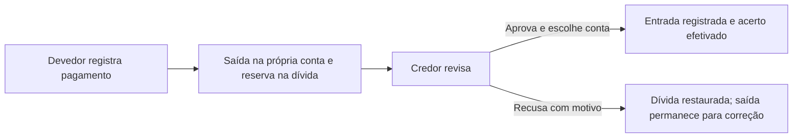

# Proposta de implementação de Rateios nesta rodada

Revisão em 25/10/2026 do documento v0.1 (RAT-01 a RAT-13, APR-01 a APR-05,
ACE-01 a ACE-09, CAT-09 e regras de geração). Comparação com o código vigente,
a avaliação v40 e a estrutura real do Supabase `wcczkultokrypdfimbsh`.
Esta entrega é uma proposta; não aplica migrações nem altera os registros financeiros.

## Decisão financeira confirmada

O usuário confirmou nesta revisão: se paga R$ 300 divididos igualmente entre três
pessoas, o resultado/Ainda posso gastar considera os **R$ 300 pagos**. Os **R$ 200
a receber** ficam em **A acertar**, separados. A participação de R$ 100 permanece
visível no detalhe, sem gerar outro lançamento na conta dos participantes.

| Momento, considerando apenas esse exemplo | Despesa do pagador | Transferências recebidas | Resultado | A receber |
| --- | ---: | ---: | ---: | ---: |
| Após o pagamento original | R$ 300 | R$ 0 | −R$ 300 | R$ 200 |
| Após um acerto de R$ 100 confirmado | R$ 300 | R$ 100 | −R$ 200 | R$ 100 |
| Após os dois acertos confirmados | R$ 300 | R$ 200 | −R$ 100 | R$ 0 |

Para o outro participante, a obrigação de R$ 100 não altera sua conta até pagar.
Ao pagar, haverá uma transferência de saída, sem uma segunda despesa do original.
A fórmula única continua Receitas − Despesas + transferências recebidas − enviadas.
Sem alternância Minha participação/Fluxo de caixa. Direitos a receber não são
tratados como dinheiro disponível, e dívidas não viram movimentações bancárias
antes do registro de seu pagamento.

Essa decisão substitui a aplicação de RAT-03/RAT-12 que anteciparia a participação
individual **no resultado financeiro principal**. Categoria individual e informações
de participação continuam necessárias para organizar/consultar rateios, sem somar
provisões aos KPIs financeiros, às despesas efetivamente registradas ou ao patrimônio.

## O que já existe e o que falta

| Aspecto | Base atual | Complemento proposto |
| --- | --- | --- |
| Divisão | Igual, por valor ou percentual; autor incluído; centavos e total validados | Preservar ajustes proporcionais dos demais, conferir totais e positivos também em cada parcela |
| Modalidades | Rateio combinado com único, parcelado e recorrente finito na avaliação | Concluir a experiência de conjunto e os testes de aprovações/alterações parciais |
| Aprovação | Solicitações com versão, aprovação/recusa com motivo e exclusão aguardando decisão | Detalhe suficiente para decidir, repetição segura e estados de aprovação separados de pagamento |
| Categoria própria | Categoria escolhida gravada na decisão | Persistir na participação e usar nas consultas pessoais; hoje nova solicitação pode apagar essa informação |
| Consulta do destinatário | Pode receber a solicitação sem ter acesso ao lançamento pela origem | Mostrar sua participação com DTO autorizado, sem abrir a conta/fatura original |
| Liquidação | Há tabela de acertos e resumo legado de compensações | Implementar o fluxo bilateral contínuo com pagamento, confirmação, recusa, parciais e limite concorrente |
| Dashboard | Tem resumo legado; proposta nova ainda é demonstrativa | Acrescentar A acertar, sem alterar a fórmula financeira confirmada |

Consulta somente de leitura encontrou **942 participações em 471 lançamentos**.
Em todos esses lançamentos a soma fecha o valor original e há uma parte do autor.
Existem **três acertos**: um efetivado com duas pontas registradas e dois aguardando
o credor, sem entrada de recebimento. Há **258 referências de participações nesses
acertos, todas resolvidas**. As novas tabelas de solicitações/decisões estão vazias:
não há evidência de aprovação v3 para atribuir automaticamente aos registros antigos.

## Experiência proposta

**Criar/dividir:** continua dentro de Lançamentos, como característica opcional de
receita/despesa. Transferências, saldo inicial e pagamento de fatura não recebem
rateio. Ao ativar Dividir, selecionar pessoas autorizadas, começar pela divisão
igual e permitir editar valores ou percentuais. Não exigir compartilhar uma conta
para ratear; não criar compartilhamentos bancários por trás do formulário.

A primeira lista aproveita os vínculos autorizados existentes. Quando precisar de
outro vínculo, usar convite privado com aceite, sem diretório público nem busca que
exponha cadastros. Não ampliar esta rodada para um cadastro completo de grupos.
Aprovações e convites ficam na aplicação; envio externo não é requisito desta proposta.

**Divisão inteligente:** manter a parte editada e redistribuir o restante
proporcionalmente entre as demais, respeitando suas proporções anteriores; quando
não houver proporções, dividir igualmente. Valores monetários em centavos são a
referência final. Resíduo da divisão igual fica com o autor; em redistribuição,
com o autor se sua parte não estiver fixada pela edição, ou com o primeiro dos
restantes em ordem estável. Mostrar o ajuste e impedir partes zeradas ou soma
incompatível. Valores/percentuais editados nunca podem criar sobras escondidas.

**Revisar:** cada pessoa vê descrição, natureza, datas, total, sua parcela, responsável
financeiro, participantes autorizados e alterações a aprovar. Escolhe sua própria
categoria/subcategoria; recusa exige motivo. Não exigir categoria para aprovar uma
exclusão ou um recebimento de acerto. Sem categoria, usar a classificação reservada
Aguardando Categorização, distinta de Aguardando aprovação. Não disponibilizar essa
classificação para seleção/edição manual e só exibi-la quando houver participação
vinculada, conforme a regra já definida para categorias do sistema.

**Conjuntos:** uma decisão e uma categoria por pessoa para o conjunto, com aplicação
às suas ocorrências. O detalhe mostra datas e valores afetados, inclusive fora do
período global, e explica o alcance. Uma alteração financeira em qualquer ocorrência
substitui o token e exige nova aprovação dos envolvidos, inclusive quem já aprovou.
Excluir uma ocorrência/alcance solicita aprovação; nada é removido antes da aprovação
exigida. Recusa não apaga o original nem desfaz automaticamente movimentações reais.
Recategorização privada não deve expor a categoria nem gerar aprovação dos demais.

**Estados independentes:** aprovação pendente/aprovada/rejeitada, classificação
pendente/escolhida e dívida em aberto/parcialmente liquidada/zerada. Aprovado não
significa pago; rejeitado não significa lançamento cancelado.

**Telas maiores:** edição no painel compacto de Lançamentos, com tabela de pessoas,
valores e percentuais; revisão e extrato em painel lateral. **Smartphone:** formulário
próprio em tela inteira, participantes em cartões e decisões/acertos em folha inferior.
Retomar rascunho preserva a divisão; rotação não apaga campos. Nenhum novo modo de cálculo.

## A acertar e liquidação

No Dashboard, uma linha compacta: **A receber · A pagar · Aprovações pendentes**.
Só aparece quando houver algo relevante. Ao abrir, mostrar saldo por pessoa e o
extrato dos rateios/acertos que o compõem. Compensar apenas dentro do mesmo par:
não usar um crédito com uma pessoa para apagar uma dívida com outra.

Despesas pagas por A geram obrigações dos demais para A. Receitas recebidas por A
que pertencem aos demais geram obrigação de A para eles: a direção se inverte.
A soma pode inverter quem deve a quem. Não gerar juros, empréstimos ou produtos
financeiros que não constam dos requisitos.

A sugestão para pagar é a dívida líquida acumulada até o mês corrente. A antecipação
pode alcançar obrigações futuras **já registradas**, até o saldo total disponível.
Recorrências virtuais ainda não geradas não autorizam pagamentos. O filtro mensal
do Dashboard não redefine o saldo bilateral: o bloco informa que é acumulado, e o
detalhe distingue vencido/atual, futuro registrado e em confirmação.

O devedor informa valor e a própria conta; não escolhe nem descobre a conta do credor.
A saída e a reserva provisória são atômicas. O credor escolhe sua conta e confirma;
a entrada nasce nessa confirmação, sem novo lançamento de receita/despesa comum.
Repetir um pedido após perda de resposta não duplica saída, entrada ou reserva.
Pagamentos simultâneos não podem ultrapassar a dívida, considerando os já em confirmação.

Preservar compatibilidade com pagamento já existente e com a opção legada vinculada
a pagamento de fatura. Nesses casos, reconhecer o registro financeiro existente:
não criar outra saída ou outra entrada. O benefício de uma fatura efetivamente paga
não é estornado por recusa do acerto; a dívida bilateral é que volta a ficar aberta.
Vínculo a movimento existente exige propriedade, valor compatível e ausência de
outro vínculo de liquidação. Movimentos ficam associados a uma única operação.

Não apagar pagamentos históricos para editar um rateio. Conservar as proteções
atuais de liquidações e implementar uma correção explícita quando houver diferença
a regularizar, com nova aprovação, em vez de remover e recriar registros vinculados.

## Reaproveitamento técnico e mudanças mínimas

- **rateios:** manter entidade/IDs e valores; acrescentar categoria individual e
  controle de versão necessários. A categoria precisa sobreviver à troca de token.
  Manter como estado interno reservado a classificação ausente, sem criar finanças.
- **solicitacoes/decisoes:** aproveitar a base e generalizar por domínio/ação:
  alteração/exclusão de rateio, acerto e convite. Verificar sessão, participação,
  token atual e versão. Cada domínio aplica seus efeitos; decidir um convite não
  pode executar uma exclusão financeira. Não usar a decisão como único cadastro
  permanente de categoria.
- **acertos_rateios:** conservar os três acertos e seus vínculos; completar versão,
  motivo de recusa, operação idempotente e estado Rejeitado. O esquema atual aceita
  somente Aguardando_Credor/Efetivado/Cancelado, portanto precisa de migração aditiva, harmonizando também as restrições de estado.
- **Lançamentos/Contas:** reconhecer as pontas de acerto como transferências
  especiais na projeção financeira, inclusive nos registros legados; não criar
  destinos fictícios nem copiar movimentos entre contas privadas. Cada pessoa só
  acessa a sua ponta e os detalhes do acerto a que tem direito.
- **Consultas:** saldo derivado de obrigações e acertos, sem total manual paralelo.
  Não descontar ao mesmo tempo o pagamento e uma marca de rateio Acertado.

Duas correções precisam vir antes da interface:

1. Hoje o gravador novo substitui participações com DELETE/INSERT, mas os acertos
   guardam IDs de participações. Preservar identidades e proteger/normalizar esses
   vínculos antes de permitir alterações no histórico; cancelar logicamente o que
   precisar sair da versão vigente sem perder referências financeiras.
2. Na produção, a responsabilidade é inferida do dono da conta/titular do cartão;
   no gravador novo, `id_usuario_credor` é preenchido com quem está digitando.
   Separar autoria do registro e responsável financeiro, especialmente nos
   adicionais. O titular e o adicional não podem virar credores por uma suposição
   baseada apenas no login. A direção da obrigação também depende de ser receita
   ou despesa, não apenas do nome de uma coluna legada.

Privacidade: DTO de participação permite consultar o rateio sem liberar a origem.
Categorias privadas só são retornadas ao seu dono. Não dar acesso a detalhes de
rateio por simples presença no mesmo grupo, projeto ou conta; preservar as permissões
financeiras do titular de cartão já homologadas, com os detalhes estritamente
necessários. Elegibilidade para convidar não equivale a direito de consultar finanças.

## Migração, sequência e aceite

1. Conciliar a base, conservar os 942 IDs e os três acertos, e introduzir os metadados
   sem mudar saldos. Registros antigos ficam identificados como legado sem evidência
   de aprovação; não marcar todos como aprovados nem disparar convites retroativos.
2. Completar rateio no lançamento, detalhes para o destinatário, categoria individual,
   estados e nova aprovação por conjunto. Manter menus de avaliação e as duas UIs.
3. Completar acertos bilaterais, reservas, confirmação/recusa e proteção concorrente,
   preservando as pontas financeiras legadas. Corrigir o resumo antigo que só soma
   participações do período e não lê a liquidação efetiva dos acertos.
4. Integrar o Dashboard a esses mesmos serviços e às regras confirmadas, com a linha
   A acertar. Publicar para avaliação, commit/push e implantação após os testes;
   promover as telas somente com homologação.

Aceite: despesa e receita rateadas; partes positivas e soma exata; centavos; parcelas
e recorrências; reaprovação de todos após alteração; token antigo sem efeito;
exclusão recusada preserva original; categorias distintas entre pessoas; participante
sem acesso à conta original; adicionais com responsável financeiro correto; acertos
parciais, futuros registrados e concorrentes; recusa com saída preservada; fatura ou
movimento já existente sem duplicidade; preservação dos vínculos dos três acertos.
No exemplo de R$ 300, os resultados devem ser exatamente os da tabela inicial.

Escopo desta análise: documento, código e catálogo/agregados reais do banco, somente
leitura. Nenhuma aprovação, pagamento, mensagem externa ou migração foi executada.
